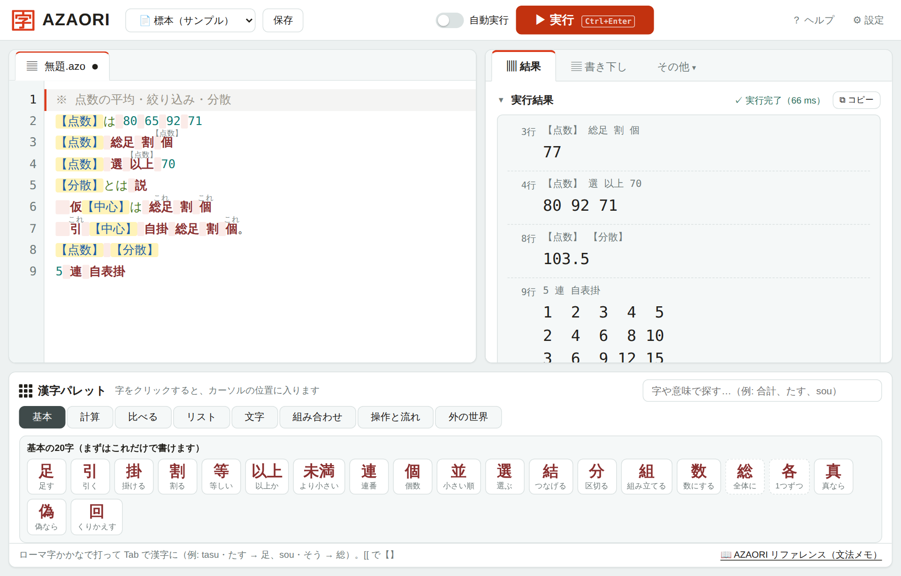
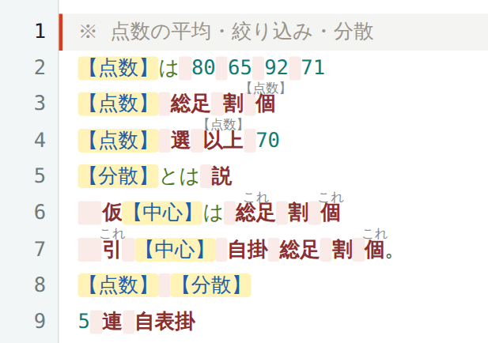

<p align="center"></p>

<h1 align="center">AZAORI（あざおり）</h1>

<p align="center">漢字を組み合わせて操作を作る、Rust 製の実験的な配列言語</p>

<p align="center">
  <a href="https://azaori.pages.dev/"></a>
</p>

<p align="center"><b><a href="https://azaori.pages.dev/">▶ ブラウザで試す</a></b>（インストール不要）</p>

AZAORI は、漢字を組み合わせて操作を作る配列言語です。独自の評価規則を持ち、CLI とブラウザのプレイグラウンドで動かせます。

```azaori
【点数】は 80 65 92 71
【点数】 総足 割 個
```

このプログラムの結果は `77` です。`総足` で点数を合計し、`個` で点数の個数を数え、合計を個数で割っています。



## まず知ってほしい二つの規則

### 漢字の演算は左から右へ

```azaori
10 引 3 掛 2
```

結果は `14` です。`10 引 3` を計算してから、`2` を掛けます。漢字の演算どうしに優先順位はありません。

一方、数学記号には通常の優先順位があります。`10 - 3 × 2` の結果は `4` です。同じ計算を表しているように見えても、漢字の演算と数学記号では読む規則が異なります。

### 右の値には、最初の値を使う演算を書ける

```azaori
【点数】 総足 割 個
```

`個` が数えるのは、割り算の直前にできた合計ではなく、式の最初に置いた `【点数】` です。省略せずに書くと、次の形になります。

```azaori
【点数】 総足 割 （【点数】 個）
```

この「主語の省略」を確かめられるように、プレイグラウンドのエディタでは、補って読む主語を演算の上に薄い字で表示します。省略を書き出した式は、CLI の `--tenkai` や、プレイグラウンドの「展開」でも確認できます。



## なぜ作っているのか

日本語話者がプログラミングに触れる入口を、別の形で広げられないかと考えたことが出発点です。その過程で APL の配列処理に強く惹かれました。

漢字に何となく抱いているイメージと、プログラムの操作を結びつけられるのではないか。たとえば `足` に `総` を付ければ全体の合計を表す `総足` になり、`各` を付ければ要素ごとの操作になります。AZAORI は、その発想を試している言語です。それぞれの字を選んだ理由は [字の由来](origins.md) にまとめています。

APL から影響を受けていますが、APL との互換を目指した言語ではありません。

## 動かしてみる

### ブラウザで

**[azaori.pages.dev](https://azaori.pages.dev/)** を開けば、インストールなしで試せます。サンプルを選んで実行したり、書き下し文や展開を見たりできます。

### 手元で

Rust が使える環境では、リポジトリのルートから次のように実行できます。

```sh
cargo run --release -- -e "1 2 3 総足"
cargo run --release -- samples/02_平均.azo --kaki --tenkai
```

`--kaki` は書き下し文、`--tenkai` は主語の省略を書き出した式を表示します。

演算や文法の詳細は [リファレンス](reference.md)、少し長いプログラムは [`samples/`](samples/) を参照してください。ビルドや検証の手順は [開発の手引き](DEVELOPMENT.md) にあります。

## 現在の状態と課題

AZAORI は、完成した汎用言語ではありません。語彙は意識的に選んでいますが、漢字から受ける印象と厳密な動作を常に一致させるのは難しく、評価規則にも慣れが必要です。

特に大きな弱点は入力の手間です。漢字や括弧を多用するため、短く書けることと素早く入力できることは同じではありません。プレイグラウンドには漢字のパレットとローマ字・かなからの入力補助を用意していますが、実際に書くときの負担も含めて検討を続けています。

仕様についての意見を歓迎します。

## Issue とセキュリティ報告

不具合、分かりにくい点、改善案は [Issue](../../issues) に投稿してください。現在、プルリクエストは受け付けていません。

**脆弱性の詳細は公開 Issue に書かないでください。** セキュリティに関する報告は、GitHub の「[Report a vulnerability](../../security/advisories/new)」から非公開で送ってください（[SECURITY.md](SECURITY.md)）。

## ライセンス

[MIT License](LICENSE) © 2026 hakoniwa
